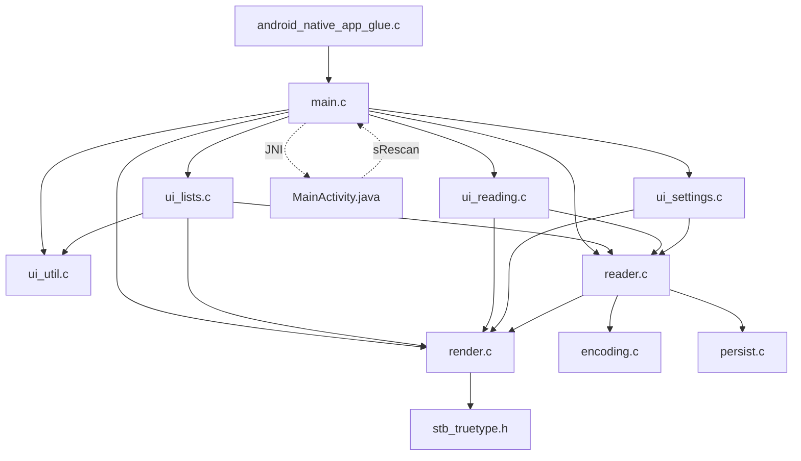

# pTEXT v0.1

Android 16+ 纯文本阅读器。C11 + Java 11，NativeActivity，arm64-v8a。

## 构建

Windows，仓库根需 `tools/`。

| 组件 | 版本 |
|---|---|
| NDK | r30 |
| CMake | 4.5.0 |
| Build Tools | 37.0.0 |
| JDK | 25 |
| Platform | 37.2 |
| Ninja | 1.13.2 |

```bat
build.bat
```

产物：`pTEXT.apk`。minSdk 36，targetSdk 37，compileSdk 37.2；versionCode 1，versionName 0.1。

`stb_truetype.h` 构建时下载，不入库：

- v1.28
- commit `9f755b604db3492df2cbeb39bf84b81e3e3932e3`
- SHA-256 `428cfe93520f2aed5e413a220b0db5bba5b17e2ebe5a64e4a8efa9eeeb67ec5f`

Release 签名：

```properties
STORE_FILE=release.keystore
STORE_PASSWORD=...
KEY_ALIAS=ptext
KEY_PASSWORD=...
```

保存为根目录 `release.properties`，放置 `release.keystore`，运行 `build.bat`。缺失时使用 debug keystore。两者均不入库。

## 架构

| 文件 | 职责 |
|---|---|
| `main.c` | 事件循环、输入状态机、JNI |
| `ui_lists.c` | 文件列表、书签列表、删除确认 |
| `ui_reading.c` | 阅读页页眉、页脚、正文绘制 |
| `ui_settings.c` | 字号、缩进、行距、主题 |
| `ui_util.c` | dp 缩放、UTF-8 转换、前缀截断 |
| `clamp.h` | 整数夹紧 |
| `reader.c` | mmap、分页、历史、书签、设置、检查点 |
| `encoding.c` | UTF-8、GBK、GB18030 |
| `persist.c` | 临时文件 + fsync + rename |
| `render.c` | 系统字体、RGB565、4-bit alpha 字形缓存 |
| `nolog.c` | `__android_log_print` 空实现 |
| `MainActivity.java` | NativeActivity 壳、SAF 导入、常亮 |

原生依赖仅 `libandroid.so`、`libc.so`。



导入：`MainActivity.onActivityResult` → `pTEXT-import` 线程 → SAF 复制 + fsync + rename → `sRescan=1` → `rd_scan_dir`。

阅读：`rd_open_file` mmap → 编码探测 → `layout_line` → `paginate_full` / `paginate_step`。

热路径：输入 → `rd_next_page` / `rd_prev_page` → `layout_line` → 解码 / 字形宽度；绘制 → `r_draw_text*` → 字形缓存。

## 数据

```text
files/<name>.txt        正文
files/<name>.txt.name   原始显示名
.prog/<name>.txt.bin    进度
.bm/<name>.txt.bin      书签
.prog/settings.bin      设置
```

`rd_scan_dir` 只读书签头和文件大小；完整 checksum 在打开书签列表时校验。书签兼容旧裸 `Bookmark` 文件。

## 操作

- 阅读页九宫格：1/2/4/7 上一页，3/6/8/9 下一页。
- 5 短按添加/移除当前页书签；页脚中央显示 `*`。
- 按住 5 三秒打开设置；面板外点击关闭。
- 文件列表：滚动、`[ + ]` 导入、长按删除、`[ * ]` 书签入口。
- 书签列表：显示首行文字，点击跳转。
- 前台常亮；5 分钟无触摸后释放常亮。

## 性能

口径：arm64-v8a release；`clock_gettime(CLOCK_MONOTONIC)`；`p50` / `p95` 使用 nearest-rank；帧 = `r_begin` → `r_end`，不含 SurfaceFlinger 提交等待。

同一文本 `bench.txt`（623,786 B，SHA-256 `7FAA22892E2D66137EB050129C42FB14F183DE340CCACB1DCD8AE32AA5CB0814`，2000 章），两台设备分别安装单线程和多线程版本。每轮从第 1 页连续执行 100 次真实下一页操作，采样 100 帧；共 3 轮，取中位。CPU 为 100 次翻页期间 `/proc/<pid>/stat` 的 `utime + stime` 差值，包含分页、预取和绘制；CPU 未锁频。

| 设备 | 版本 | 帧 p50 | 帧 p95 | max | CPU / 100 次翻页 | CPU / 帧 |
|---|---|---:|---:|---:|---:|---:|
| PKR110 / Android 17 | 单线程 | 3.44 ms | 5.66 ms | 8.23 ms | 780 ms | 7.8 ms |
| PKR110 / Android 17 | 多线程 | 2.27 ms | 4.10 ms | 7.82 ms | 680 ms | 6.8 ms |
| PJA110 / Android 16 | 单线程 | 15.78 ms | 28.96 ms | 32.73 ms | 2,820 ms | 28.2 ms |
| PJA110 / Android 16 | 多线程 | 9.43 ms | 15.07 ms | 18.16 ms | 2,420 ms | 24.2 ms |

多线程相对单线程：PKR110 p50 降约 34%、p95 降约 28%、CPU 降约 13%；PJA110 p50 降约 40%、p95 降约 48%、CPU 降约 14%。

CPU 频率中位（`time_in_state` 差值）：

```text
PKR110 MT: policy0 1029 MHz, policy6 1018 MHz
PKR110 ST: policy0 1024 MHz, policy6 1018 MHz
PJA110 MT: policy0 821 MHz, policy3 997 MHz, policy7 864 MHz
PJA110 ST: policy0 819 MHz, policy3 1003 MHz, policy7 864 MHz
```

PJA110 的翻页线程多数停在 729/864 MHz，PKR110 的线程可升到 2.4–2.7 GHz；两者阶段耗时差与频率差基本一致。PJA110 在持续压测下可升到 2.5/2.6 GHz，说明高耗时主要来自 OEM governor 对短翻页负载的升频策略，不是绘制代码路径差异。

单线程/多线程基准 APK 均为 119,600 B；正常 release 为 119,598 B。正文采用主线程 + 两个工作线程三路绘制，字形预加载失败时回退单线程。

## 省电

- 阅读空闲按分钟边界休眠，不再每秒唤醒主循环。
- 无网络、无唤醒锁；无持续后台线程，导入使用一次性线程。
- 暗色主题为纯黑背景；夜间正文使用灰色，减少亮像素。
- 阅读页仅在输入、翻页或分钟变化时重绘，不做持续动画。
- `ANativeWindow_setFrameRate(60)` 实测只能改变应用请求，OEM 仍将面板保持 120 Hz，未纳入发布。
- 面板刷新率只能由系统设置控制；日常省电优先降低亮度、缩短熄屏时间，必要时把系统峰值刷新率设为 60 Hz。

## 范围

- 仅 Android 16+ / arm64-v8a。
- 系统字体，不打包字体。
- 100 文件、50 书签、64 页历史、80 行/页、200 字符/行。
- 不提供搜索、目录、章节识别、Markdown。

## 许可

代码 MIT，见 [LICENSE](LICENSE)。

`stb_truetype` v1.28，Sean Barrett / RAD Game Tools，Public Domain 或 MIT；构建时下载，不随仓库分发。
