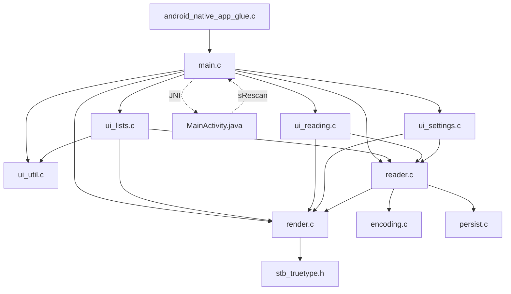

# pTEXT v0.1

Android 16+ 纯文本阅读器。C11 + Java 11，NativeActivity，arm64-v8a。

## 构建

Windows，仓库根需 `tools/`。

| 组件 | 版本 |
|---|---|
| NDK | r30 |
| CMake | 4.5.0 |
| Build Tools | 37.0.0 |
| JDK | 25 |
| Platform | 37.2 |
| Ninja | 1.13.2 |

```bat
build.bat
```

产物：`pTEXT.apk`。minSdk 36，targetSdk 37，compileSdk 37.2；versionCode 1，versionName 0.1。

`stb_truetype.h` 构建时下载，不入库：

- v1.28
- commit `9f755b604db3492df2cbeb39bf84b81e3e3932e3`
- SHA-256 `428cfe93520f2aed5e413a220b0db5bba5b17e2ebe5a64e4a8efa9eeeb67ec5f`

Release 签名：

```properties
STORE_FILE=release.keystore
STORE_PASSWORD=...
KEY_ALIAS=ptext
KEY_PASSWORD=...
```

保存为根目录 `release.properties`，放置 `release.keystore`，运行 `build.bat`。缺失时使用 debug keystore。两者均不入库。

## 架构

| 文件 | 职责 |
|---|---|
| `main.c` | 事件循环、输入状态机、JNI |
| `ui_lists.c` | 文件列表、书签列表、删除确认 |
| `ui_reading.c` | 阅读页页眉、页脚、正文绘制 |
| `ui_settings.c` | 字号、缩进、行距、主题 |
| `ui_util.c` | dp 缩放、UTF-8 转换、前缀截断 |
| `clamp.h` | 整数夹紧 |
| `reader.c` | mmap、分页、历史、书签、设置、检查点 |
| `encoding.c` | UTF-8、GBK、GB18030 |
| `persist.c` | 临时文件 + fsync + rename |
| `render.c` | 系统字体、RGB565、8-bit 灰度字形缓存、256 项 RGB565 LUT |
| `nolog.c` | `__android_log_print` 空实现 |
| `MainActivity.java` | NativeActivity 壳、SAF 导入、常亮 |

原生依赖仅 `libandroid.so`、`libc.so`。



导入：`MainActivity.onActivityResult` → `pTEXT-import` 线程 → SAF 复制 + fsync + rename → `sRescan=1` → `rd_scan_dir`。

阅读：`rd_open_file` mmap → 编码探测 → `layout_line` → `paginate_full` / `paginate_step`。

热路径：输入 → `rd_next_page` / `rd_prev_page` → `layout_line` → 解码 / 字形宽度；绘制 → `r_draw_text*` → 字形缓存。

## 数据

```text
files/<name>.txt        正文
files/<name>.txt.name   原始显示名
.prog/<name>.txt.bin    进度
.bm/<name>.txt.bin      书签
.prog/settings.bin      设置
```

`rd_scan_dir` 只读书签头和文件大小；完整 checksum 在打开书签列表时校验。书签兼容旧裸 `Bookmark` 文件。

## 操作

- 阅读页九宫格：1/2/4/7 上一页，3/6/8/9 下一页。
- 5 短按添加/移除当前页书签；页脚中央显示 `*`。
- 按住 5 三秒打开设置；面板外点击关闭。
- 文件列表：滚动、`[ + ]` 导入、长按删除、`[ * ]` 书签入口。
- 书签列表：显示首行文字，点击跳转。
- 前台常亮；5 分钟无触摸后释放常亮。

## 性能

当前 release `9aa2378` 使用 8-bit 灰度字形缓存和 256 项 RGB565 LUT。真实小说《樱树抽芽时，想你.txt》485,562 B，连续 100 页；每台设备两轮，排除前 5 页冷启动，取平均。数值为 `r_begin` → `r_end` 的整页绘制时间，包含清屏、页眉页脚和正文。

| 设备 | 灰度缓存 | 旧双池缓存 |
|---|---:|---:|
| PKR110 / Android 17 | 2.13 ms/页 | 2.46 ms/页 |
| PJA110 / Android 16 | 3.26 ms/页 | 3.28 ms/页 |

灰度版相对旧双池：PKR 约快 14%，PJA 基本持平。

字形缓存：

```text
8 MiB 单池
4096 项
1024 B 块
8-bit 灰度 + 256 项 RGB565 LUT
```

单线程/多线程 APK 均已构建；本轮 A/B 只采样多线程版本。

## 省电

- 阅读空闲按分钟边界休眠，不再每秒唤醒主循环。
- 无网络、无唤醒锁；无持续后台线程，导入使用一次性线程。
- 暗色主题为纯黑背景；夜间正文使用灰色，减少亮像素。
- 阅读页仅在输入、翻页或分钟变化时重绘，不做持续动画。

## 范围

- 仅 Android 16+ / arm64-v8a。
- 系统字体，不打包字体。
- 100 文件、50 书签、64 页历史、80 行/页、200 字符/行。
- 不提供搜索、目录、章节识别、Markdown。

## 许可

代码 MIT，见 [LICENSE](LICENSE)。

`stb_truetype` v1.28，Sean Barrett / RAD Game Tools，Public Domain 或 MIT；构建时下载，不随仓库分发。
