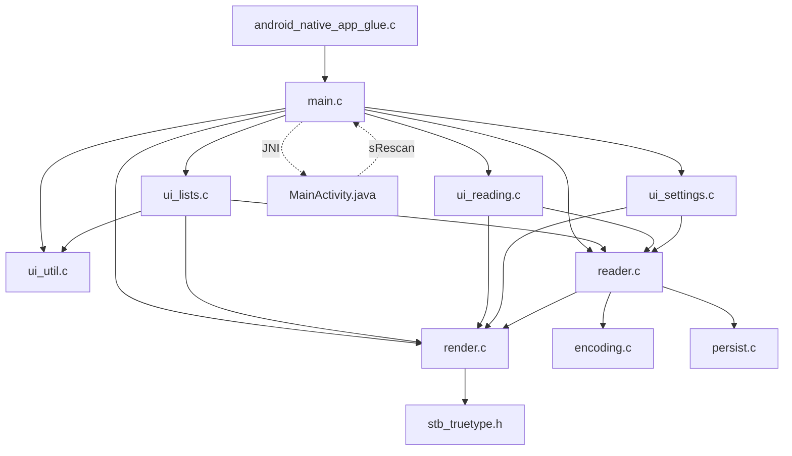

# pTEXT v0.1

Android 17 纯文本阅读器。C11 + Java 11，NativeActivity，arm64-v8a。

## 构建

Windows，仓库根需 `tools/`。

| 组件 | 版本 |
|---|---|
| NDK | r30 |
| CMake | 4.5.0 |
| Build Tools | 37.0.0 |
| JDK | 25 |
| Platform | 37.2 |
| Ninja | 1.13.2 |

```bat
build.bat
```

产物：`pTEXT.apk`。minSdk 37，targetSdk 37，compileSdk 37.2；versionCode 1，versionName 0.1。

`stb_truetype.h` 构建时下载，不入库：

- v1.28
- commit `9f755b604db3492df2cbeb39bf84b81e3e3932e3`
- SHA-256 `428cfe93520f2aed5e413a220b0db5bba5b17e2ebe5a64e4a8efa9eeeb67ec5f`

Release 签名：

```properties
STORE_FILE=release.keystore
STORE_PASSWORD=...
KEY_ALIAS=ptext
KEY_PASSWORD=...
```

保存为根目录 `release.properties`，放置 `release.keystore`，运行 `build.bat`。缺失时使用 debug keystore。两者均不入库。

## 架构

| 文件 | 职责 |
|---|---|
| `main.c` | 事件循环、输入状态机、JNI |
| `ui_lists.c` | 文件列表、书签列表、删除确认 |
| `ui_reading.c` | 阅读页页眉、页脚、正文绘制 |
| `ui_settings.c` | 字号、缩进、行距、主题 |
| `ui_util.c` | dp 缩放、UTF-8 转换、前缀截断 |
| `clamp.h` | 整数夹紧 |
| `reader.c` | mmap、分页、历史、书签、设置、检查点 |
| `encoding.c` | UTF-8、GBK、GB18030 |
| `persist.c` | 临时文件 + fsync + rename |
| `render.c` | 系统字体、RGB565、4-bit alpha 字形缓存 |
| `nolog.c` | `__android_log_print` 空实现 |
| `MainActivity.java` | NativeActivity 壳、SAF 导入、常亮 |

原生依赖仅 `libandroid.so`、`libc.so`。



导入：`MainActivity.onActivityResult` → `pTEXT-import` 线程 → SAF 复制 + fsync + rename → `sRescan=1` → `rd_scan_dir`。

阅读：`rd_open_file` mmap → 编码探测 → `layout_line` → `paginate_full` / `paginate_step`。

热路径：输入 → `rd_next_page` / `rd_prev_page` → `layout_line` → 解码 / 字形宽度；绘制 → `r_draw_text*` → 字形缓存。

## 数据

```text
files/<name>.txt        正文
files/<name>.txt.name   原始显示名
.prog/<name>.txt.bin    进度
.bm/<name>.txt.bin      书签
.prog/settings.bin      设置
```

`rd_scan_dir` 只读书签头和文件大小；完整 checksum 在打开书签列表时校验。书签兼容旧裸 `Bookmark` 文件。

## 操作

- 阅读页九宫格：1/2/4/7 上一页，3/6/8/9 下一页。
- 5 短按添加/移除当前页书签；页脚中央显示 `*`。
- 按住 5 三秒打开设置；面板外点击关闭。
- 文件列表：滚动、`[ + ]` 导入、长按删除、`[ * ]` 书签入口。
- 书签列表：显示首行文字，点击跳转。
- 前台常亮；5 分钟无触摸后释放常亮。

## 验证

Visual Studio x64 开发者提示符：

```bat
tests\run_tests.bat
```

Linux 或 WSL：

```sh
sh tests/run_reader_tests.sh
```

- 编码：1,065,822 cases PASS。
- reader/persist：WSL PASS；ASan/UBSan PASS。
- 设备回归：启动、前后台、中文、书签、导入、图标、5 分钟释放、翻页重置计时、列表 UI 通过。
- 未验证：导入进度逐帧。

## 性能

口径：PKR110，Android 17，arm64-v8a；release APK；`clock_gettime(CLOCK_MONOTONIC)`；`p50` / `p95` 使用 nearest-rank；帧 = `r_begin` → `r_end`；不含 SurfaceFlinger 提交等待。性能包临时启用 `PTEXT_BENCH` 与 liblog，正式包无日志代码。

本轮复测：阅读页帧 n=100；CPU 未锁频，记录了实际频率；其余路径待复测。

| 指标 | 读数 | 口径 |
|---|---|---|
| 阅读页帧 | p50 4.11 / p95 6.69 / max 10.45 ms | 帧绘制，n=100，NEON8 五轮中位 |
| APK | 119,599 B | 当前 release |
| PSS | 约 25.3 MB | 默认字号，阅读 100 页后 |
| PSS | 约 31.3 MB | 最大字号，读到第 271 页末页后 |

同轮 CPU 频率（`time_in_state` 差值）：

```text
policy0 小核: 76.0% @ 556.8 MHz
policy6 大核: 99.9% @ 1017.6 MHz
```

帧延迟随系统调度和频率有明显波动；标量双像素历史 n=100 样本 p50 5.00 / p95 8.61 / max 11.08 ms。

NEON 五轮 n=100 中位：

```text
NEON4: p50 4.16 / p95 7.03 ms
NEON8: p50 4.11 / p95 6.69 ms
```

设备端逐像素对比测试通过；CPU 频率仍保持在最低档。NEON8 APK 为 **119,599 B**，增加约 4 KiB。

字形存储 A/B（n=100，默认字号）：

| 版本 | 帧 p50 | PSS |
|---|---:|---:|
| 2048 × 8 KiB 固定位图 | 5.20 ms | 36.7 MB |
| 2048 索引 + 8 MiB 变长位图池 | 5.11 ms | 25.3 MB |

最大字号下位图池可正常回收、无崩溃；读完整本后 PSS 约 31 MB，受系统共享内存影响会在 31–33 MB 间波动，不是单调增长。

stb 临时池实测峰值约 **35 KiB**，已从 16 MiB 缩至 **256 KiB**；该池此前未驻留，因此 PSS 基本不变，但静态保留量减少约 15.75 MiB。字形块池峰值 **1995/2048**，已接近满，不能缩小。

优化项：`-O2` 编译；预计算 16 级 alpha 混合表、共享字形绘制、删除重复页脚清屏；`APP_CMD_WINDOW_REDRAW_NEEDED` 在完成帧后 20 ms 内去重；字形缓存 2048 项，位图按 4 KiB 块变长分配；字形按 alpha 字节双像素写入，全透明字节跳过；ARM64 NEON 4 像素查表、8 像素循环，并保留重叠/边界标量回退；删除无实际作用的整屏 dirty-rect 抽象。

## 省电

- 阅读空闲按分钟边界休眠，不再每秒唤醒主循环。
- 无网络、无唤醒锁；无持续后台线程，导入使用一次性线程。
- 暗色主题为纯黑背景；夜间正文使用灰色，减少亮像素。
- 阅读页仅在输入、翻页或分钟变化时重绘，不做持续动画。
- `ANativeWindow_setFrameRate(60)` 实测只能改变应用请求，OEM 仍将面板保持 120 Hz，未纳入发布。
- 面板刷新率只能由系统设置控制；日常省电优先降低亮度、缩短熄屏时间，必要时把系统峰值刷新率设为 60 Hz。

## 范围

- 仅 Android 17 / arm64-v8a。
- 系统字体，不打包字体。
- 100 文件、50 书签、64 页历史、80 行/页、200 字符/行。
- 不提供搜索、目录、章节识别、Markdown。

## 许可

代码 MIT，见 [LICENSE](LICENSE)。

`stb_truetype` v1.28，Sean Barrett / RAD Game Tools，Public Domain 或 MIT；构建时下载，不随仓库分发。
