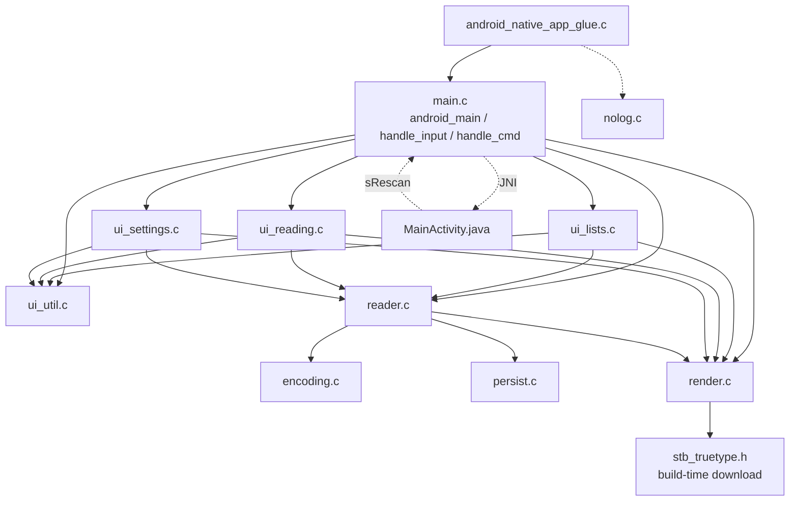
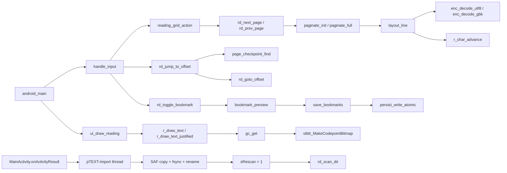

# pTEXT v0.1

Android 17 纯文本阅读器。C11 + Java 11，NativeActivity，arm64-v8a。

## 1. 项目简介

| 组件 | 职责 |
|---|---|
| `main.c` | 事件循环、输入状态机、JNI |
| `ui_lists.c` | 文件列表、书签列表、删除确认 |
| `ui_reading.c` | 阅读页页眉、页脚、正文绘制 |
| `ui_settings.c` | 字号、缩进、行距、主题设置面板 |
| `ui_util.c` | dp 缩放、UTF-8 转 UTF-32、单次前缀宽度截断 |
| `clamp.h` | 共享整数夹紧 |
| `reader.c` | mmap、分页、历史、书签、设置、页码检查点 |
| `encoding.c` | UTF-8、GBK、GB18030 解码与编码探测 |
| `persist.c` | 临时文件 + fsync + rename |
| `render.c` | 系统字体、RGB565、4-bit alpha 字形缓存 |
| `nolog.c` | `__android_log_print` 空实现，用于移除 liblog |
| `MainActivity.java` | NativeActivity 壳、SAF 导入、5 分钟常亮 |
| `res/` | 自适应启动图标 |
| `tests/` | 编码、分页、书签、持久化测试 |
| `design/` | 图标 SVG 与 512px 预览 |

原生依赖仅 `libandroid.so`、`libc.so`。

## 2. 数据流

1. SAF 导入：文件复制到 `files/*.txt`，原始显示名写入同名 `.name`。
2. `rd_scan_dir` 扫描 `.txt`，书签数量只读文件头和大小；完整 checksum 在打开书签列表时校验。
3. `rd_open_file` mmap 文件，探测编码，读取进度与书签。
4. `layout_line`、`paginate_full`、`paginate_step` 生成页。
5. 进度、书签、设置原子写入 `.prog` / `.bm`。

## 3. 函数图谱

静态调用关系，省略系统库。

### 3.1 模块级



### 3.2 热路径



## 4. 构建

需要 Windows 和仓库根 `tools/`：

| 工具 | 版本 |
|---|---|
| NDK | r30 |
| CMake | 4.5.0 |
| Build Tools | 37.0.0 |
| JDK | 25 |
| Platform | 37.2 |
| Ninja | 1.13.2 |

```bat
build.bat
```

构建脚本会下载 `stb_truetype.h`：

- 版本：v1.28
- 提交：`9f755b604db3492df2cbeb39bf84b81e3e3932e3`
- SHA-256：`428cfe93520f2aed5e413a220b0db5bba5b17e2ebe5a64e4a8efa9eeeb67ec5f`
- 文件不纳入 git；下载后校验哈希。

产物：`pTEXT.apk`；minSdk 37，targetSdk 37，compileSdk 37.2；versionCode 1，versionName 0.1。

release 签名：

1. 本地生成 `release.keystore`。
2. 根目录创建 `release.properties`：

```properties
STORE_FILE=release.keystore
STORE_PASSWORD=...
KEY_ALIAS=ptext
KEY_PASSWORD=...
```

3. 运行 `build.bat`。缺少文件时使用 debug keystore。

keystore 与 properties 不入库。

## 5. 交互

- 阅读页九宫格：1/2/4/7 上一页，3/6/8/9 下一页。
- 5 短按添加/移除当前页书签；页脚中央显示 `*`。
- 按住 5 三秒打开设置；面板外点击关闭。
- 设置四行：字号、缩进、行距、主题。
- 文件列表：滚动、`[ + ]` 导入、长按删除、`[ * ]` 书签入口。
- 书签列表：显示书签页首行文字，点击跳转。
- 前台保持常亮；5 分钟无触摸后清除常亮，交还系统熄屏。

## 6. 数据目录

```text
files/<name>.txt        正文
files/<name>.txt.name   原始显示名
.prog/<name>.txt.bin    进度
.bm/<name>.txt.bin      书签
.prog/settings.bin      设置
```

书签文件使用 `BmHeader`：magic、version、count、FNV checksum；兼容旧裸 `Bookmark` 文件。

## 7. 验证

```bat
tests\run_tests.bat
```

```sh
sh tests/run_reader_tests.sh
```

- 编码测试：1,065,822 cases PASS。
- reader/persist 测试使用 POSIX 接口，需 Linux/WSL；MSVC 不能直接编译。
- 设备已验：冷启动、UTF-8/GBK、11MB 文件、空文件、书签列表/跳转、设置持久化、强杀恢复、旋转、最新图标、无日志构建、8 次快速及 20 秒前后台重绘、stb_truetype 1.28 中文。
- 待验证：5 分钟实际释放、导入进度 Toast 逐帧显示、最新列表重构的 UI 回归。

## 8. 范围

- 仅 Android 17 / arm64-v8a。
- 系统字体，不打包字体。
- 100 文件、50 书签、64 页历史、80 行/页、200 字符/行。
- 不提供搜索、目录、章节识别、Markdown。

## 9. 许可证

代码 MIT，见 [LICENSE](LICENSE)。

`stb_truetype` v1.28，Sean Barrett / RAD Game Tools，Public Domain 或 MIT；构建时下载，不随仓库分发。
